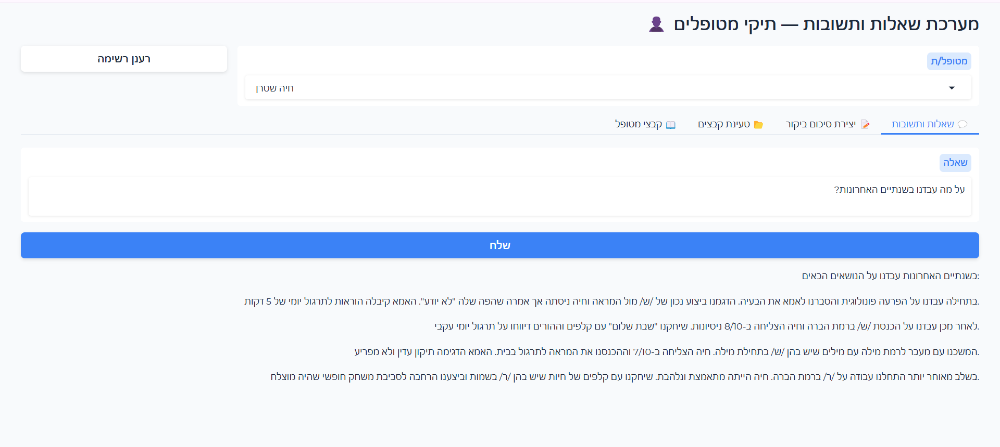
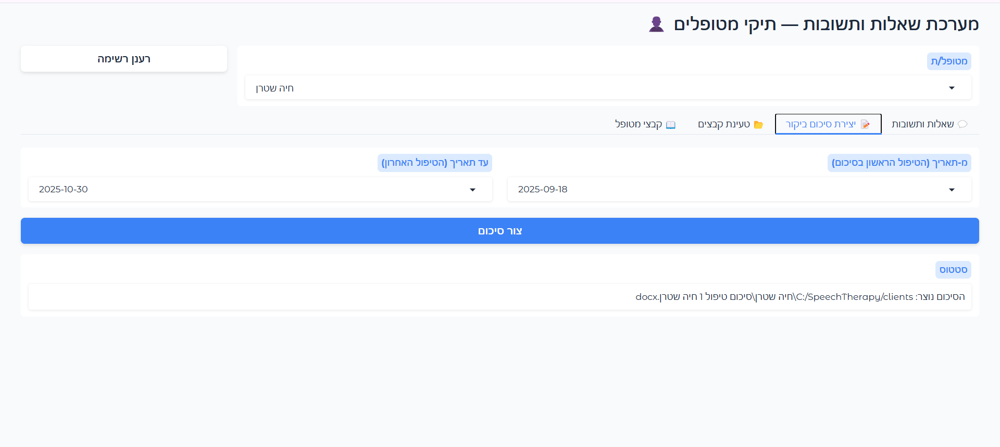

# Clinical RAG — Patient Q&A System


A retrieval-augmented generation system for a speech-language pathology clinic. The system allows the clinician to ask natural-language questions in Hebrew about patient records and receive grounded answers drawn directly from the patient files.

## Why I built this

A speech-language clinic I work with was managing patient records as a folder of `.docx` files per patient — diagnosis reports, visit summaries, treatment plans — searched by hand whenever a clinician needed to answer a question like "what treatment approach did we agree on in March?" or "which sessions covered articulation exercises?". I built this as a real tool for that clinic: a Hebrew-language Q&A system that retrieves and grounds its answers strictly in the patient's own documents, with a hard requirement that no real patient data ever leaves the local machine in identifiable form — everything is de-identified before indexing and re-identified only when displaying the final answer back to the clinician.

## Purpose

Patient data is stored as `.docx` files organized in a folder per patient. The system ingests those files, de-identifies them, stores structured metadata in a local SQLite database, and indexes treatment-plan content in Pinecone for semantic search. Queries are answered by Claude Haiku 4.5, strictly from retrieved context.

Supported document types: diagnosis reports, clinic visit summaries, treatment plans.

All patient data is de-identified before leaving the local machine. Real names and identifiers are stored in a local re-identification map and are re-applied to answers after generation.

## Demo

> Screenshots below use fully synthetic patient data created for demonstration purposes — no real patient information appears in this repository.

**Ask a question in Hebrew, get an answer grounded in the patient's documents:**


**Generate a clinic visit summary document from a date range:**



## Setup (first run)

1. Copy `.env.example` to `.env` and fill in your API keys:
   ```
   COHERE_API_KEY=...
   ANTHROPIC_API_KEY=...
   PINECONE_API_KEY=...
   ```

2. Edit `config.yaml` to set `patients_root` to the path of your patient files folder — a single path, or a YAML list of paths to scan several folders. A patient folder with the same name in more than one root is treated as the same patient.

3. Double-click `setup.bat`. It installs Python and the dependencies, checks the NER model,
   initializes the database, opens `.env` in Notepad if it is missing, and creates a
   **"מערכת שאלות ותשובות"** shortcut on the desktop and in the Start menu.

   The shortcut points to the folder `setup.bat` was run from — if the project folder is
   moved, run `setup.bat` again.

## Daily use

Double-click the **מערכת שאלות ותשובות** icon (desktop or Start menu). The app opens in its
own window — no console, no browser. Closing the window shuts everything down. Opening it
again while it is already running just brings the existing window to the front.

If something goes wrong at startup (missing `.env`, port in use, no connection to Pinecone…)
a Hebrew message explains what to do; details are in `logs/desktop.log`.

## Installing at a client

The client has no Git, so the app ships as a ZIP built from the merged code plus the NER model.

1. **Build** — on the developer machine, from the main project folder (the one that has `models/`):
   ```
   uv run python scripts/build_release.py
   ```
   Output: `dist/ClinicalQA-<date>-<commit>.zip` (~390 MB). It packages `origin/main` and refuses
   to produce a ZIP that lacks the model or contains `.env`, `data/`, `logs/` or `.venv/`.
2. **Before the session** — the client opens her own Anthropic, Cohere and Pinecone accounts
   (billed to the clinic). See the Hebrew guide, section 1.
3. **At the client** (in person or remote desktop):
   1. Extract the ZIP with the destination set to `C:\` → `C:\ClinicalQA` (short path, no Hebrew).
   2. Edit `C:\ClinicalQA\config.yaml` and set `patients_root` to the clinic's patient folder(s).
   3. Double-click `setup.bat`. When Notepad opens `.env`, paste the three keys from the
      client's dashboards, save and close.
   4. Set a monthly spending limit in the Anthropic Console (and in the others where available).
   5. Open the app from the desktop icon, load the files (tab "טעינת קבצים") and ask one test
      question.
   6. Show the client the Hebrew user guide, `User-Guide.html`, in the install folder.

**Developers:** `start.bat` still runs the app with a console; open `http://localhost:7860`.

- Tab 1 (Q&A): select a patient, type a question in Hebrew, click Submit.
- Tab 2 (Generate summary): select a patient and a session date, click Generate to create a clinic visit summary `.docx` in the patient folder.

## Directory structure

```
.
├── app/                    # Application source code
│   ├── ingestion/          # Document parsers (Family A and B adapters)
│   ├── deidentification/   # De-id pass 1, NER, validation pass 2, re-id map
│   ├── storage/            # SQLite schema/CRUD and Pinecone client
│   ├── query/              # LLM extraction, intent routing, retrieval
│   ├── generation/         # Q&A workflow and generate-summary workflow
│   ├── prompts/            # All prompt templates (centralized)
│   └── ui/                 # Gradio interface
├── evaluation/             # LLM-as-judge evaluation runner
├── tests/                  # Unit and E2E tests (synthetic data only)
├── scripts/                # Dev tools: release ZIP build, ingestion dry run, egress audit
├── models/                 # ONNX NER model (`python -m app.setup ner`), gitignored; shipped in the release ZIP
├── data/                   # Runtime data (SQLite DB, re-id map) — gitignored
├── logs/                   # Rotating log files — gitignored
├── config.yaml             # Non-secret configuration
├── .env.example            # API key template
├── pyproject.toml          # Project dependencies (uv)
├── setup.bat               # First-time setup script (creates the shortcuts)
├── create_shortcut.ps1     # Desktop + Start menu shortcut (called by setup.bat)
├── start.bat               # Developer launch script (with console)
└── User-Guide.html         # Hebrew end-user guide for the clinic
```

## Requirements

- Python 3.11+
- [uv](https://github.com/astral-sh/uv) package manager
- Cohere API key (embeddings)
- Anthropic API key (Claude Haiku)
- Pinecone API key (vector store)
